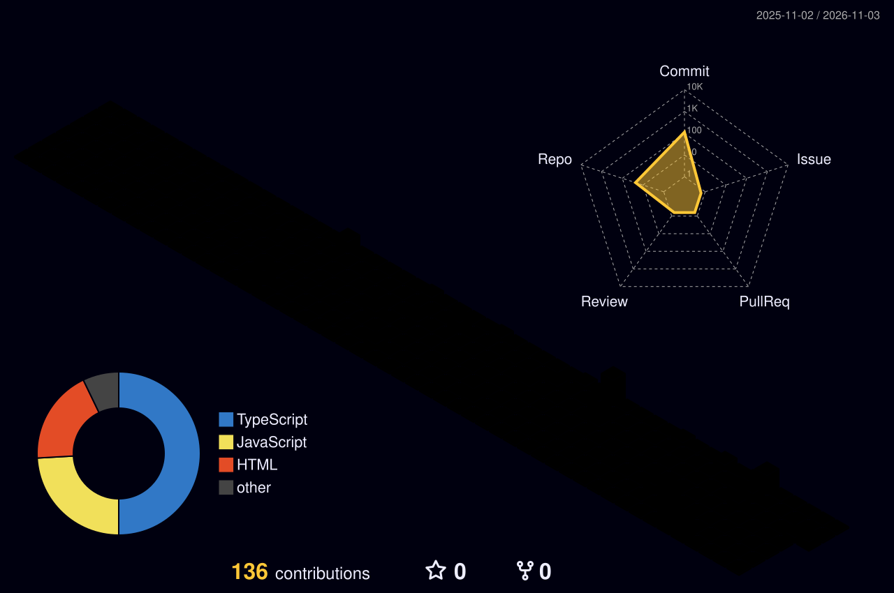

<p align="center">
  
</p>

<p align="center">
  
</p>

<p align="center">
  
</p>

```text
╔══════════════════════════════════════════════════════════════════════╗
║ 📡 CYBER-GRID TELEMETRY // DISTRICT: HARSHIL-2004                    ║
║                                                                      ║
║   👾 [NETRUNNER] : Harshil Nayee (Level 2+ AI-Augmented Engineer)    ║
║   🏙️ [VOXEL GRID]: 3D Cyber City Powered by Production Commits ⚡   ║
║   ⚔️ [EQUIPMENT] : React • Node.js • Express • MongoDB • Cloud       ║
║   📍 [BASE CAMP] : Ahmedabad, India [Server: Earth]                  ║
║   🚀 [STATUS]    : 100% City Grid Synchronized // Ready for Deploy   ║
║                                                                      ║
║   > "Scanning the voxel skyline... All systems operational." 🕹️     ║
╚══════════════════════════════════════════════════════════════════════╝
```
